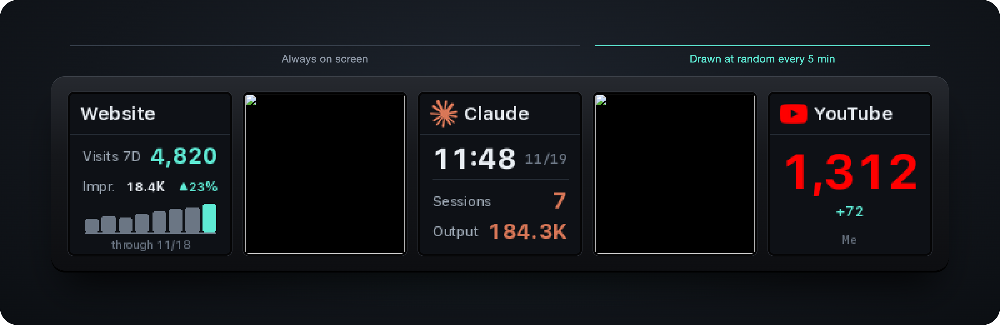

# Divoom Times Gate Dashboard

**English** · [繁體中文](README.zh-TW.md)



This turns the five 128×128 screens of a Divoom Times Gate into a desk dashboard for your own numbers:

- **Website traffic and SEO.** It shows 7-day visits, search impressions and search clicks, with an 8-week trend, read from a JSON endpoint you own.
- **Followers on your own accounts.** It shows YouTube subscribers and Threads and X followers, each with its change from a week ago. These are read from public pages, so you need no API keys.
- **Claude Code usage.** It shows today's sessions and output tokens, read from local transcripts. Nothing is uploaded.
- **Rotation.** Screens 1–3 stay fixed. Every 5 minutes, screens 4–5 show two tiles drawn at random from a pool, and the same pair never comes up twice in a row.

The image above comes from `python3 dash.py --demo`, which uses the made-up data in `examples/`.

## Install with an AI assistant

Use an assistant with terminal and local-file access, such as Claude Code or Codex. Paste this:

```text
Help me set up this Divoom Times Gate dashboard on my Mac:
https://github.com/kelvin-sl/divoom-times-gate-dashboard

Clone the repository into a local project folder, then read README.md and SKILL.md.
First create a Python virtual environment, install Pillow, run the tests, and show
me the demo preview. This step needs no lamp or Cloudflare account.
Then guide me through the lamp setup, asking for missing settings. Have me enter
tokens locally, and preserve any existing configuration. Set up the optional
Cloudflare collector only if I choose to use it. Verify each completed step and
tell me what remains untested.
```

[SKILL.md](SKILL.md) is the setup guide for the assistant; keep it with the project files.
For manual installation, follow [Quick start](#quick-start).
The current setup targets macOS. Website traffic and SEO require a JSON endpoint you provide;
this repository does not include a GA4 or Search Console connector.

## Architecture

```
 Cloudflare (always on)                      Your Mac (nothing stays running)
┌───────────────────────────────┐          ┌───────────────────────────────────────┐
│ Worker cron, every 15 min     │  GET     │ launchd runs run.sh every 60 s, exits │
│  YouTube   public channel page│ /latest  │  1. curl the snapshot → data/latest   │
│  Threads/X headless browser   │ ───────▶ │     (every 5 min; keeps the old file  │
│  JSON      your traffic / SEO │ Bearer   │      if the pull fails)               │
│            endpoint           │ token    │  2. dash.py reads data/ + ~/.claude   │
│ KV: latest, day:<date> (60 d) │          │     → five 128×128 tiles → the lamp   │
└───────────────────────────────┘          └──────────────────┬────────────────────┘
                                                              │ POST http://<lamp-ip>/post
                                                              ▼  (LAN, LocalToken)
                                                       Divoom Times Gate
```

The work is split this way for four reasons:

- **Collection runs in the cloud.** Numbers keep coming in while your computer is off or asleep, so there is always a day to compare against for "a week ago". Threads and X only show their counts after JavaScript runs, and Cloudflare Browser Run (formerly Browser Rendering) on the free plan can run it.
- **Rendering runs locally.** The lamp only accepts requests from the LAN, and your Claude Code transcripts exist only on your computer.
- **Nothing stays resident.** Each run does its work and exits. With the Claude scan cached, a run takes 0.2 s and 47 MB. The full Claude scan happens every 5 minutes and took about 5.7 s and 61 MB. Nothing uses memory between runs.
- **The data is a file in a folder.** `data/latest.json` is the latest snapshot, so other tools can read it directly.

If you only want the clock and Claude usage, skip Cloudflare: leave `COLLECTOR_URL` empty, and the other tiles show "Collecting…".

## Requirements

- A Divoom Times Gate on the same LAN and subnet as your computer, for example both on `192.168.1.x`.
- The lamp's IP and its **LocalToken**. Without the token, the lamp answers `DeviceToken is err`.
- macOS and Python 3.9+. Install Pillow in the virtual environment below. The renderer uses macOS system fonts, including PingFang for CJK text; the schedule uses launchd. Other operating systems need font and scheduler changes.
- For the optional collector: a Cloudflare account and Node **22.12.0 or newer**, as required by the Wrangler version in `worker/package-lock.json`. See [Gotchas](#gotchas) for free-plan limits.

## Quick start

### 1. Preview locally

No lamp, tokens or Cloudflare account are needed for the demo.

```sh
git clone https://github.com/kelvin-sl/divoom-times-gate-dashboard
cd divoom-times-gate-dashboard
python3 -m venv .venv
.venv/bin/python -m pip install pillow
.venv/bin/python -m unittest discover tests
.venv/bin/python dash.py --demo          # → out/preview.png
open out/preview.png
```

### 2. Push to the lamp

```sh
mkdir -p ~/.config/times-gate-dashboard
cp -n env.example ~/.config/times-gate-dashboard/env
chmod 600 ~/.config/times-gate-dashboard/env
cp -n examples/scenes.json examples/accounts.json config/
.venv/bin/python -c 'import sys; print(sys.executable)'
```

The copy commands preserve existing files. Edit `~/.config/times-gate-dashboard/env`:
set `DIVOOM_IP` and `DIVOOM_TOKEN` to your lamp's values, and set `PYTHON` to the full path
printed above, quoted if it contains spaces. Leave `COLLECTOR_URL` and `PULL_TOKEN` empty
for this first local update. launchd does not read your shell profile or activate a virtual environment.

```sh
./run.sh
```

Check the five screens on the lamp. The clock and local Claude usage should appear;
tiles without collected data show placeholders. Once this works, enable the schedule:

```sh
./install-launchd.sh
```

It runs every minute and logs to `~/Library/Logs/times-gate-dashboard.log`.
To remove the schedule, run `./install-launchd.sh uninstall`.

### 3. Deploy the collector (Cloudflare Worker)

Skip this section if you only want local Claude usage and the clock. Otherwise, finish step 2 first.
Edit `config/accounts.json`: replace example accounts with your own and remove sources you will not use.
Website metrics need your own JSON endpoint; see [Connecting website traffic and SEO](#connecting-website-traffic-and-seo).
Keep account IDs consistent with `config/scenes.json`.

From the repository root:

```sh
cd worker
node --version                             # must be >= 22.12.0
npm ci
npm test
cp -n wrangler.example.jsonc wrangler.jsonc
npx wrangler login
npx wrangler kv namespace create KV
```

Put the returned namespace ID into `kv_namespaces[0].id` in `worker/wrangler.jsonc`.
For an existing installation, keep its namespace ID and skip namespace creation.
Then, still in `worker/`:

```sh
openssl rand -hex 24                        # make a token
npx wrangler secret put PULL_TOKEN          # paste that token when prompted
```

Save the same token as `PULL_TOKEN` in `~/.config/times-gate-dashboard/env`.
For each JSON account with `auth_secret`, also create the matching Worker secret, for example
`npx wrangler secret put SITE_API_TOKEN`, and enter that endpoint's token.

```sh
npx wrangler deploy                         # prints https://times-gate-collector.<you>.workers.dev
cd ..
```

**Before uploading configuration**, put the deployed URL (without a trailing slash) in
`COLLECTOR_URL` in the env file and check that `PULL_TOKEN` matches the Worker secret.

```sh
./lamp.sh push-config                       # upload config/accounts.json to KV
```

Expect `{"ok":true}`. After the next successful cron run (scheduled every 15 minutes),
`/latest` contains a snapshot and the Mac picks it up on its next pull.
Threads and X normally refresh every two hours (see [Gotchas](#gotchas)).
To change accounts later, edit `config/accounts.json` and run `./lamp.sh push-config`; you don't need to redeploy.

These commands trigger a run by hand and help with debugging:

```sh
set -a
. "$HOME/.config/times-gate-dashboard/env"
set +a
curl -X POST -H "Authorization: Bearer $PULL_TOKEN" "$COLLECTOR_URL/collect"     # 202, runs in the background
curl -H "Authorization: Bearer $PULL_TOKEN" "$COLLECTOR_URL/probe?group=threads&handle=your.handle"
curl -H "Authorization: Bearer $PULL_TOKEN" "$COLLECTOR_URL/last_error"
```

## Configuration

### `config/accounts.json`: what to collect

```json
{
  "youtube": [{ "id": "yt-me", "label": "Me", "channel": "UC…channel id" }],
  "threads": [{ "id": "threads-me", "label": "Me", "handle": "your.handle" }],
  "x":       [{ "id": "x-me", "label": "Me", "handle": "your_handle" }],
  "json":    [{ "id": "site", "url": "https://…", "auth_secret": "SITE_API_TOKEN",
                "fields": { "visits_7d": "traffic.visits", "weekly_visits": "traffic.weekly" } }]
}
```

- `id` is the name tiles use to refer to the account, and `label` is the short name shown on the tile. `theme` optionally picks a theme for that account.
- To find a YouTube channel id, search the channel page source for `channelId`, or use About → Share channel → Copy channel ID.
- A `json` account is read with GET from its `url`. If it has an `auth_secret`, the collector takes the value of the Worker secret with that name and sends it as `Authorization: Bearer …`. `fields` maps dotted paths in the response, such as `a.b.0`, to flat numbers. The next section shows how to set this up.

### Connecting website traffic and SEO

The GA4 and Search Console APIs both need OAuth or a service account, and those credentials don't belong in the lamp's collector. The cleaner setup is a **read-only JSON endpoint** of your own, which the collector reads every 15 minutes:

```
GA4 Data API ─────┐
                  ├─▶ your small service (pulls on a schedule, stores) ─▶ GET /api/summary (Bearer token) ─▶ collector
Search Console ───┘
```

The endpoint only has to return the numbers you want on the lamp. For example:

```json
{
  "through": "11/18",
  "traffic": { "visits": 4820, "visits_prev": 4100, "weekly": [2100, 2600, 2450, 3100, 3500, 3900, 4100, 4820] },
  "search":  { "impressions": 18400, "impressions_prev": 14900, "clicks": 512, "clicks_prev": 431,
               "weekly": [120, 180, 210, 260, 330, 390, 431, 512] }
}
```

Map those paths in `fields` in `accounts.json` (see `examples/accounts.json`). Then show them with `stats` tiles:

- **Website tile:** the main number is 7-day visits, the second is search impressions with a % change, and the bars are 8 weeks of visits.
- **Search tile:** the main number is 7-day search clicks, the second is impressions, and the bars are 8 weeks of clicks.

For a new site, these are the numbers worth checking every day:

- **Visits:** whether anyone is coming.
- **Search impressions:** whether Google has started to show you in results. These usually move weeks before clicks do.
- **Search clicks:** whether rankings are turning into traffic.

Search Console data runs about 2–3 days behind, so the tile shows a "through" date at the bottom.

If your analytics tool already has an API that takes a token (GET + Bearer), you can point `url` at it and pick fields with `fields`, with no separate service.

### `config/scenes.json`: what the five screens show

```json
{
  "theme": "night",
  "rotate": { "auto": true, "every_minutes": 5 },
  "fixed": [ screen 1, screen 2, screen 3 ],
  "pool":  [ { "id": "youtube", "tile": "big", "account": "yt-me" }, … ]
}
```

| `tile` | Shows | Parameters |
|---|---|---|
| `claude` | Clock, plus today's Claude Code sessions and output tokens | — |
| `big` | One account: followers (large), weekly change, handle | `account` |
| `rows` | 2–3 accounts on one platform; each row is label, followers, weekly change | `accounts` |
| `total` | Followers summed over several accounts, with per-platform subtotals | `accounts`, `title` |
| `stats` | A JSON account: main number, second number with % change, 8 bars | `account`, `main`, `second`, `bars`, `note` |
| `pending` | A tile not connected yet: dotted frame and a note | `title`, `pending` |

Every tile also takes `title` and `theme`. To change the text printed on tiles, use `labels`, for example `"labels": {"total": "followers", "collecting": "warming up"}`. The available keys are in `LABELS` in `dash.py`.

To control screens 4–5:

```sh
./lamp.sh list                   # the pool; ▶ marks the two on screen
./lamp.sh next                   # draw a new pair now
./lamp.sh show youtube x         # pin two tiles; with one id, screen 5 is random
./lamp.sh auto off               # stop redrawing automatically
```

### Themes

There are two built-in themes:

- `night` has thin rules and shows rising numbers in the accent colour.
- `poster` has condensed upper-case titles and a 2px rule, and puts rising numbers in an accent-coloured chip.

To use your own colours and logo, add `config/themes.json`. Any field you leave out comes from `night`:

```json
{ "mine": { "bg": "#101418", "ink": "#f2f2f2", "accent": "#ff7a00", "mark": "/abs/path/logo.png", "wordmark": "My Site" } }
```

Platform colours, such as YouTube red and Claude orange, are only used for main numbers, bars and logos. The theme sets the background and the colours for up and down.

## Times Gate local API notes

Divoom has not published full documentation for the Times Gate. This is the part this project uses and has tested:

```sh
curl -X POST http://<lamp-ip>/post -d '{"Command":"Draw/GetHttpGifId","LocalToken":123456}'
# → {"error_code":0,"PicId":57}
```

`Draw/SendHttpGif` sends one image to the screens you pick:

| Parameter | Value |
|---|---|
| `LcdArray` | `[0,0,1,0,0]` targets screen 3; send one screen at a time |
| `PicNum` / `PicOffset` | `1` / `0` for a single image |
| `PicWidth` | `128` |
| `PicID` | Must be **greater than** the `PicId` returned by `GetHttpGifId`, or the lamp keeps the old image |
| `PicSpeed` | Milliseconds per animation frame; any value works for a single image |
| `PicData` | Base64 JPEG, 128×128 |

## Gotchas

- **Python started by launchd can't reach the lamp** (`No route to host`). macOS Local Network privacy blocks it, but the system `/usr/bin/curl` is not affected. That is why `dash.py` pushes images through curl rather than Python's HTTP.
- **The computer and the lamp may be on different subnets.** Wi-Fi and wired networks are often served by different routers, for example a modem and a mesh router that each hand out addresses. The lamp and the computer need addresses from the same router.
- **Cloudflare Browser Run's free plan allows 10 minutes a day.** Past that it returns 429 until the next UTC day. One pass over a few Threads and X accounts takes about 25 s, so those sources run only on the first cron of every second hour (even UTC hours). The runs in between reuse the last numbers. For more accounts or fresher numbers, change `browserDue` in `parse.js` or move to a paid plan.
- **Threads and X pages never go network-idle.** Wait for the word "followers" to appear on the page instead.
- **A manual `/collect` gets cut off early.** A run started by hand inside `waitUntil` stops after about 30 s, while cron runs get longer. To see a full pass, wait for the next cron run.
- **Threads "recent views" only shows when you are logged in.** Public pages show only the follower count, and this project does not use a logged-in session.
- **When a source fails,** the collector keeps the previous numbers and marks them with `stale_since`, so the lamp never goes blank.

## Scraping public pages

YouTube, Threads and X numbers are read from public pages rather than official APIs. A site redesign can break this, and a platform's terms may limit automated access. Decide for yourself, and use it only for your own accounts. Requests are spaced 1.5–4.5 s apart at random, and browser sources run only every two hours. If you prefer official APIs, use the YouTube Data API or the Threads API behind your own endpoint and connect it as a `json` account.

## Verification

| What | How | Result (2026-11-19) |
|---|---|---|
| Rendering | `python3 -m unittest discover tests` (9 tests) | Pass |
| No data / corrupt snapshot | Test: with an invalid `latest.json`, five tiles with dotted frames still render | Pass |
| Rotation | Tests: never repeats the previous pair; no redraw before the interval | Pass |
| Collector parsing | `cd worker && npm test` (6 tests: K/M suffixes, login walls, failures keep old data) | Pass |
| Live YouTube read | Ran `sources.youtube` in Node against YouTube's own channel | Got subscribers, views, videos |
| Live Threads / X read | Rendered public pages in local Chrome, parsed with the same `parse.js` | Got follower counts |
| Worker bundle | `npx wrangler deploy --dry-run` | Builds (137 KB gzip) |
| Push to the lamp | `./lamp.sh show x threads` against a real lamp | All five screens `error_code: 0` |

## Other Times Gate projects

Summarised from each repo's GitHub description (2026-11-19). Most are general controllers or computer monitors:

| Project | What it does | How this repo differs |
|---|---|---|
| [averhaegen/hacs-divoom-times-gate-dev](https://github.com/averhaegen/hacs-divoom-times-gate-dev) | Home Assistant integration | That needs Home Assistant; this needs only Python and curl |
| [raishack/divoom-times-gate-controller](https://github.com/raishack/divoom-times-gate-controller) | Local controller: images, GIFs, widgets, playlists | General control; this one is about your numbers and growth |
| [shallow-seek-nothing/divoom-times-gate](https://github.com/shallow-seek-nothing/divoom-times-gate) | Five-panel PC dashboard (GPU / CPU / services / clock / weather) | Watches your computer; this watches your site and accounts |
| [johnpc/divoom-time-gate](https://github.com/johnpc/divoom-time-gate) | Shows Home Assistant status on the Times Gate (TypeScript) | Same as above |
| [4ch1m/pixoo-rest](https://github.com/4ch1m/pixoo-rest) | REST API for the Divoom **Pixoo** | A different device |

What sets this repo apart:

- Website traffic, SEO and followers share one set of screens.
- Collection runs in the cloud, so weekly changes keep building while your computer is off.
- Nothing stays running on your Mac.
- It has a built-in Claude Code usage tile.

## Files

| Path | Purpose |
|---|---|
| `dash.py` | Render and push (one file, only needs Pillow) |
| `run.sh` / `lamp.sh` / `install-launchd.sh` | One update pass / control screens 4–5 / install the schedule |
| `worker/` | Cloudflare collector (`parse.js` pure functions, `sources.js` per platform, `index.js` schedule and endpoints) |
| `examples/` | Made-up config and snapshot for `--demo` and the tests |
| `assets/logos/` | Platform logos, generated from SVG by `tools/build_logos.py` |
| `SKILL.md` | Lets Claude Code or another AI assistant set this up for you |

## License

MIT. Platform logos are from [Simple Icons](https://simpleicons.org/) 16.36.0 (CC0). Divoom, Times Gate, YouTube, Threads, X and Claude are trademarks of their respective owners. This project is not affiliated with any of them; follow each owner's guidelines when using their logos.
