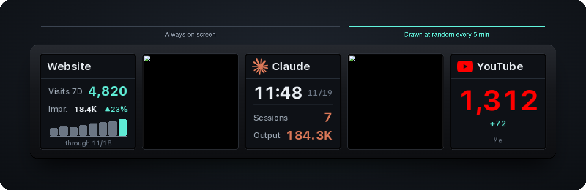

# Divoom Times Gate Dashboard

[English](README.md) · **繁體中文**



把 Divoom Times Gate 桌燈的五塊螢幕，變成看自己成績的儀表板：

- **網站流量與 SEO**：7 天造訪、搜尋曝光、搜尋點擊和 8 週走勢，從你自己的 JSON 端點讀。
- **個人帳號粉絲**：YouTube 訂閱、Threads、X 追蹤數，和一週前比漲跌，讀公開頁，不用 API 金鑰。
- **Claude Code 用量**：今天開了幾個 session、輸出多少 token，讀本機紀錄，不上傳。
- **輪播**：第 1–3 格固定，第 4–5 格每 5 分鐘從候選池隨機抽兩張，不會連續兩輪同一對。

上圖是 `python3 dash.py --demo` 用 `examples/` 的虛構資料畫的。

## 讓 AI 協助安裝

使用能操作終端機與本機檔案的 AI 助手，例如 Claude Code 或 Codex，貼上這段：

```text
幫我在 Mac 設定這個 Divoom Times Gate 儀表板：
https://github.com/kelvin-sl/divoom-times-gate-dashboard

把 repo clone 到本機專案資料夾，先讀 README.zh-TW.md 和 SKILL.md。
先建立 Python 虛擬環境、安裝 Pillow、跑測試，並讓我看到 demo 預覽。
這一步不需要桌燈或 Cloudflare 帳號。
接著引導我設定桌燈，缺少設定時再問我。Token 由我在本機填入，保留既有設定。
只有我選擇使用雲端收集器時，才設定 Cloudflare。
每完成一段都驗證結果，最後告訴我哪些部分還沒驗到。
```

[SKILL.md](SKILL.md) 是給 AI 的安裝指引，和專案檔案放在一起即可。
手動安裝請看[快速開始](#快速開始)。目前的安裝流程以 macOS 為準。
網站流量與 SEO 需要你提供 JSON 端點；這個 repo 沒有內建 GA4 或 Search Console 連接器。

## 架構

```
 Cloudflare（不用開機）                          你的 Mac（不常駐）
┌────────────────────────────────┐           ┌──────────────────────────────────────┐
│ Worker cron 每 15 分鐘           │  GET      │ launchd 每 60 秒跑一次 run.sh，跑完就結束 │
│  YouTube   公開頻道頁（fetch）    │ /latest   │  1. curl 拉快照 → data/latest.json     │
│  Threads/X 無頭瀏覽器讀公開頁     │ ───────▶  │     （每 5 分鐘一次，失敗就沿用舊檔）     │
│  JSON      你的網站流量／SEO 端點 │ Bearer    │  2. dash.py 讀 data/ ＋ ~/.claude       │
│ KV: latest、day:日期（60 天）     │ token     │     → 畫 5 張 128×128 → 推到燈          │
└────────────────────────────────┘           └──────────────┬───────────────────────┘
                                                            │ POST http://燈的IP/post
                                                            ▼  （區網，LocalToken）
                                                     Divoom Times Gate
```

為什麼這樣拆：

- **收集放雲端**：電腦關機或睡眠時資料照樣收，「一週前」的比較才有資料。Threads 和 X 要跑 JavaScript 才看得到數字，Cloudflare Browser Run（原名 Browser Rendering）免費方案就能用。
- **畫圖放本機**：燈只接受區網的請求，Claude Code 的紀錄也只在你的電腦上。
- **本機不常駐**：每分鐘跑一次就結束。實測 Claude 紀錄有快取時一次 0.2 秒、47 MB；每 5 分鐘重掃一次 Claude 紀錄約 5.7 秒、61 MB。兩次之間不佔記憶體。
- **資料是資料夾裡的檔案**：`data/latest.json` 就是最新快照，想自己做別的用途直接讀。

只想看時鐘和 Claude 用量，可以不架 Cloudflare：`COLLECTOR_URL` 留空就好，其他格子會顯示「Collecting…」。

## 需要什麼

- Divoom Times Gate，和電腦在同一個區網（同網段，例如都是 `192.168.1.x`）。
- 燈的 IP 和 **LocalToken**。少了 token，燈會回 `DeviceToken is err`。
- macOS、Python 3.9 以上。Pillow 會安裝在下方的虛擬環境裡。渲染使用 macOS 系統字型，中文字用蘋方；排程使用 launchd。其他作業系統需要調整字型與排程。
- （選配收集器）Cloudflare 帳號、Node **22.12.0 以上**，這是 `worker/package-lock.json` 鎖定的 Wrangler 版本要求。免費方案限制見[坑](#坑)。

## 快速開始

### 1. 先在本機看畫面

Demo 不需要桌燈、token 或 Cloudflare 帳號。

```sh
git clone https://github.com/kelvin-sl/divoom-times-gate-dashboard
cd divoom-times-gate-dashboard
python3 -m venv .venv
.venv/bin/python -m pip install pillow
.venv/bin/python -m unittest discover tests
.venv/bin/python dash.py --demo          # → out/preview.png
open out/preview.png
```

### 2. 推到燈上

```sh
mkdir -p ~/.config/times-gate-dashboard
cp -n env.example ~/.config/times-gate-dashboard/env
chmod 600 ~/.config/times-gate-dashboard/env
cp -n examples/scenes.json examples/accounts.json config/
.venv/bin/python -c 'import sys; print(sys.executable)'
```

上述複製指令會保留已存在的檔案。編輯 `~/.config/times-gate-dashboard/env`：
把 `DIVOOM_IP`、`DIVOOM_TOKEN` 換成你的桌燈設定，`PYTHON` 填入剛才印出的完整路徑，
路徑含空白時加上引號。第一次本機更新先讓 `COLLECTOR_URL`、`PULL_TOKEN` 保持空白。
launchd 不會讀你的 shell 設定，也不會自動啟用虛擬環境。

```sh
./run.sh
```

檢查燈上五格：應看到時鐘與本機 Claude 用量，尚未收集資料的格子顯示佔位畫面。
確認成功後，再開啟排程：

```sh
./install-launchd.sh
```

之後每分鐘更新，日誌在 `~/Library/Logs/times-gate-dashboard.log`。
要移除排程，執行 `./install-launchd.sh uninstall`。

### 3. 架收集器（Cloudflare Worker）

只看本機 Claude 用量與時鐘可跳過這段；要收集遠端資料，請先完成第 2 步。
編輯 `config/accounts.json`，換成自己的帳號並刪除不用的來源。
網站數據需要自備 JSON 端點，見[網站流量與 SEO 怎麼接](#網站流量與-seo-怎麼接)。
帳號 ID 須與 `config/scenes.json` 一致。

從 repo 根目錄開始：

```sh
cd worker
node --version                             # 須為 22.12.0 以上
npm ci
npm test
cp -n wrangler.example.jsonc wrangler.jsonc
npx wrangler login
npx wrangler kv namespace create KV
```

把回傳的 namespace ID 填進 `worker/wrangler.jsonc` 的 `kv_namespaces[0].id`。
若是既有安裝，保留原本的 namespace ID，跳過建立步驟。
接著仍在 `worker/` 執行：

```sh
openssl rand -hex 24                        # 產生一組 token
npx wrangler secret put PULL_TOKEN          # 提示輸入時貼上剛才的 token
```

在 `~/.config/times-gate-dashboard/env` 的 `PULL_TOKEN` 填同一組 token。
每個 JSON 來源若有 `auth_secret`，也要建立同名 Worker secret，例如
`npx wrangler secret put SITE_API_TOKEN`，輸入該端點的 token。

```sh
npx wrangler deploy                         # 會印出 https://times-gate-collector.<你>.workers.dev
cd ..
```

**上傳設定之前**，先把部署網址填入 env 的 `COLLECTOR_URL`（結尾不要加 `/`），
並確認 `PULL_TOKEN` 與 Worker secret 相同。

```sh
./lamp.sh push-config                       # 把 config/accounts.json 上傳到 KV
```

應回傳 `{"ok":true}`。下一輪 cron 成功後（每 15 分鐘排程一次），`/latest` 會有快照，
Mac 下次拉取時就能取得。Threads／X 通常每兩小時更新，原因見[坑](#坑)。
之後改帳號只要改 `config/accounts.json` 再 `./lamp.sh push-config`，不用重新部署。

手動觸發與除錯：

```sh
set -a
. "$HOME/.config/times-gate-dashboard/env"
set +a
curl -X POST -H "Authorization: Bearer $PULL_TOKEN" "$COLLECTOR_URL/collect"     # 202，背景跑
curl -H "Authorization: Bearer $PULL_TOKEN" "$COLLECTOR_URL/probe?group=threads&handle=你的帳號"
curl -H "Authorization: Bearer $PULL_TOKEN" "$COLLECTOR_URL/last_error"
```

## 設定

### `config/accounts.json`：要抓誰

```json
{
  "youtube": [{ "id": "yt-me", "label": "Me", "channel": "UC…頻道 ID" }],
  "threads": [{ "id": "threads-me", "label": "Me", "handle": "your.handle" }],
  "x":       [{ "id": "x-me", "label": "Me", "handle": "your_handle" }],
  "json":    [{ "id": "site", "url": "https://…", "auth_secret": "SITE_API_TOKEN",
                "fields": { "visits_7d": "traffic.visits", "weekly_visits": "traffic.weekly" } }]
}
```

- `id` 是格子引用的代號。`label` 是格子上的短名。`theme` 可以指定這個帳號用哪個佈景主題。
- YouTube 的頻道 ID 在頻道頁原始碼裡搜尋 `channelId`，或在「關於 → 分享頻道 → 複製頻道 ID」找到。
- `json` 來源會用 GET 讀 `url`。如果有 `auth_secret`，就從 Worker 的同名 secret 讀出值，加上 `Authorization: Bearer …`。`fields` 用點路徑把回應攤平成數字，例如 `a.b.0`。做法見下一節。

### 網站流量與 SEO 怎麼接

GA4 和 Search Console 的 API 都要 OAuth 或服務帳號，金鑰不適合放在燈的收集器裡。比較乾淨的做法，是你自己準備一個**唯讀 JSON 端點**，收集器每 15 分鐘讀一次：

```
GA4 Data API ─────┐
                  ├─▶ 你的小服務（排程拉資料、存起來） ─▶ GET /api/summary（Bearer token）─▶ 收集器
Search Console ───┘
```

端點只要回傳你想上燈的數字，例如：

```json
{
  "through": "11/18",
  "traffic": { "visits": 4820, "visits_prev": 4100, "weekly": [2100, 2600, 2450, 3100, 3500, 3900, 4100, 4820] },
  "search":  { "impressions": 18400, "impressions_prev": 14900, "clicks": 512, "clicks_prev": 431,
               "weekly": [120, 180, 210, 260, 330, 390, 431, 512] }
}
```

然後在 `accounts.json` 的 `fields` 對應路徑（見 `examples/accounts.json`），再用 `stats` 格顯示：

- **網站格**：主數字是 7 天造訪，次數字是搜尋曝光和漲跌 %，長條是 8 週造訪。
- **搜尋格**：主數字是 7 天搜尋點擊，次數字是曝光，長條是 8 週點擊。

對新網站來說，這幾個數字最值得每天看：

- **造訪**：有沒有人來。
- **搜尋曝光**：Google 有沒有開始把你排進結果；通常比點擊早幾週動。
- **搜尋點擊**：排名有沒有轉成流量。

Search Console 的資料大約晚 2–3 天，所以格子底下會顯示「through 日期」。

如果你已經有網站分析工具，而且它提供 API token（GET＋Bearer），可以直接把 `url` 指過去，用 `fields` 挑欄位，不必另寫服務。

### `config/scenes.json`：五格放什麼

```json
{
  "theme": "night",
  "rotate": { "auto": true, "every_minutes": 5 },
  "fixed": [ 第 1 格, 第 2 格, 第 3 格 ],
  "pool":  [ { "id": "youtube", "tile": "big", "account": "yt-me" }, … ]
}
```

| `tile` | 內容 | 參數 |
|---|---|---|
| `claude` | 時鐘＋今天的 Claude Code session 數與輸出 token | — |
| `big` | 單一帳號：粉絲（大字）、週變化、帳號 | `account` |
| `rows` | 同平台 2–3 個帳號，每列：簡稱｜粉絲｜週變化 | `accounts` |
| `total` | 多個帳號的粉絲合計＋各平台小計 | `accounts`、`title` |
| `stats` | JSON 來源：主數字、次數字與漲跌 %、8 根長條 | `account`、`main`、`second`、`bars`、`note` |
| `pending` | 還沒接的格子：點線框＋說明 | `title`、`pending` |

每格都可以加 `title`、`theme`。格子上的英文字可以用 `labels` 改成中文，例如 `"labels": {"total": "總粉絲", "collecting": "收集中"}`，可改的鍵見 `dash.py` 的 `LABELS`。

切換第 4–5 格：

```sh
./lamp.sh list                   # 候選池，▶ 是現在顯示的兩張
./lamp.sh next                   # 立刻重抽
./lamp.sh show youtube x         # 指定兩張；只給一張的話，第 5 格隨機
./lamp.sh auto off               # 停止自動重抽
```

### 佈景主題

內建兩套：

- `night`：細分隔線，往上的數字用強調色。
- `poster`：窄體大寫標題、2px 粗線，往上的數字放在強調色小方塊裡。

要用自己的配色和 logo，就新增 `config/themes.json`，沒寫的欄位沿用 `night`：

```json
{ "mine": { "bg": "#101418", "ink": "#f2f2f2", "accent": "#ff7a00", "mark": "/abs/path/logo.png", "wordmark": "My Site" } }
```

平台色只用在主要數字、長條和 logo，例如 YouTube 紅、Claude 橘；底色和漲跌顏色都交給佈景主題決定。

## Times Gate 區網 API 筆記

Divoom 沒有公開 Times Gate 的完整文件。以下是這個專案實際用到、測過的部分：

```sh
curl -X POST http://燈的IP/post -d '{"Command":"Draw/GetHttpGifId","LocalToken":123456}'
# → {"error_code":0,"PicId":57}
```

`Draw/SendHttpGif` 推一張圖到指定螢幕：

| 參數 | 值 |
|---|---|
| `LcdArray` | `[0,0,1,0,0]` 表示第 3 格，一次推一格 |
| `PicNum` / `PicOffset` | 單張圖填 `1` / `0` |
| `PicWidth` | `128` |
| `PicID` | 必須**大於** `GetHttpGifId` 回的 `PicId`，否則燈不換圖 |
| `PicSpeed` | 動畫每幀毫秒數，單張隨意 |
| `PicData` | base64 的 JPEG（128×128） |

## 坑

- **launchd 跑的 Python 連不到燈**（`No route to host`）。macOS 的「本地網路」隱私權會擋 launchd 啟動的 Python，系統內建的 `/usr/bin/curl` 不受影響。所以 `dash.py` 推圖時呼叫 curl，不用 Python 的 HTTP。
- **電腦和燈不在同一網段**：Wi‑Fi 和有線網路常常由不同的路由器發 IP，例如數據機和 mesh 路由器各發一段。燈和電腦要拿同一台發的 IP。
- **Cloudflare Browser Run 免費方案一天 10 分鐘**，超過會回 429，直到隔天（UTC）。讀幾個 Threads／X 帳號一輪約 25 秒，所以只在每兩小時（UTC 偶數點）第一次 cron 時讀，其他輪次沿用上一份數字。帳號多或要更即時，改 `parse.js` 的 `browserDue`，或升級付費方案。
- **Threads 和 X 的頁面永遠不會 network idle**：要等頁面出現 `followers` 字樣，不能等網路靜止。
- **手動 `/collect` 會被提早切斷**。在 `waitUntil` 裡跑的手動觸發大約 30 秒就會被中斷，cron 觸發的時間比較長。要看完整一輪，就等下一次 cron。
- **Threads 的 recent views 只有登入才看得到**。公開頁只有粉絲數，這個專案不使用登入狀態。
- **某個來源失敗時**，沿用上一份數字，並標上 `stale_since`。燈不會變空白。

## 爬公開頁的風險

YouTube、Threads、X 的數字是讀公開頁面，沒有走官方 API。平台改版可能讓抓取失敗；條款也可能限制自動存取。請自己判斷，只用在你自己的帳號。請求之間間隔 1.5–4.5 秒亂數，每兩小時才讀一次瀏覽器來源。想走正式管道，可以改用 YouTube Data API 或 Threads API，再透過 `json` 來源接進來。

## 驗證

| 項目 | 怎麼驗 | 結果（2026-11-19） |
|---|---|---|
| 渲染 | `python3 -m unittest discover tests`（9 項） | 通過 |
| 沒資料、快照壞掉 | 測試：`latest.json` 不是合法 JSON 時，仍畫出 5 格點線框 | 通過 |
| 輪播 | 測試：不重複上一對、時間未到不重抽 | 通過 |
| 收集器解析 | `cd worker && npm test`（6 項，含 K／M 縮寫、登入牆、失敗沿用） | 通過 |
| YouTube 實抓 | 在 Node 跑 `sources.youtube` 讀 YouTube 官方頻道 | 取得訂閱、觀看、影片數 |
| Threads／X 實抓 | 本機 Chrome 渲染公開頁，交給同一份 `parse.js` | 取得粉絲數 |
| Worker 打包 | `npx wrangler deploy --dry-run` | 成功（gzip 137 KB） |
| 推到燈 | `./lamp.sh show x threads` 推到實機 | 5 格皆 `error_code: 0` |

## 和其他 Times Gate 專案比較

依各 repo 在 GitHub 上的描述整理（2026-11-19）。這些專案大多是通用控制器，或在顯示電腦狀態：

| 專案 | 做什麼 | 跟這個 repo 的差別 |
|---|---|---|
| [averhaegen/hacs-divoom-times-gate-dev](https://github.com/averhaegen/hacs-divoom-times-gate-dev) | Home Assistant 整合 | 要有 Home Assistant；這裡只要 Python＋curl |
| [raishack/divoom-times-gate-controller](https://github.com/raishack/divoom-times-gate-controller) | 本機控制器：圖片、GIF、widget、播放清單 | 通用控制；這裡專注在數據與成長 |
| [shallow-seek-nothing/divoom-times-gate](https://github.com/shallow-seek-nothing/divoom-times-gate) | 五格電腦儀表板（GPU／CPU／服務／時鐘／天氣） | 監控電腦；這裡監控社群與自己的 API |
| [johnpc/divoom-time-gate](https://github.com/johnpc/divoom-time-gate) | 在 Times Gate 顯示 Home Assistant 狀態（TypeScript） | 同上 |
| [4ch1m/pixoo-rest](https://github.com/4ch1m/pixoo-rest) | Divoom **Pixoo** 的 REST API | 不同機型 |

這個 repo 的特點：網站流量、SEO 與個人帳號粉絲放在同一組畫面；收集在雲端，關機也照樣累積週變化；本機不常駐；內建 Claude Code 用量格。

## 檔案

| 路徑 | 用途 |
|---|---|
| `dash.py` | 渲染＋推送（單檔，只依賴 Pillow） |
| `run.sh` / `lamp.sh` / `install-launchd.sh` | 一次更新 / 切換第 4–5 格 / 安裝排程 |
| `worker/` | Cloudflare 收集器（`parse.js` 純函式、`sources.js` 各平台、`index.js` 排程與端點） |
| `examples/` | 虛構的設定與快照，`--demo` 和測試用 |
| `assets/logos/` | 平台 logo，`tools/build_logos.py` 從 SVG 產生 |
| `SKILL.md` | 給 Claude Code 等 AI 助手照著幫你安裝 |

## 授權

MIT。平台 logo 取自 [Simple Icons](https://simpleicons.org/) 16.36.0（CC0）。Divoom、Times Gate、YouTube、Threads、X、Claude 皆為各自公司的商標，本專案與它們無關，使用 logo 時請遵守各公司的規範。
